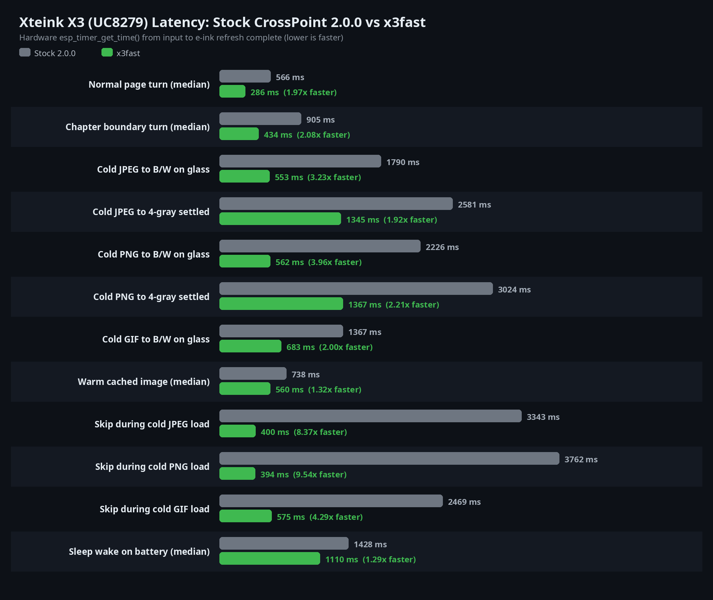
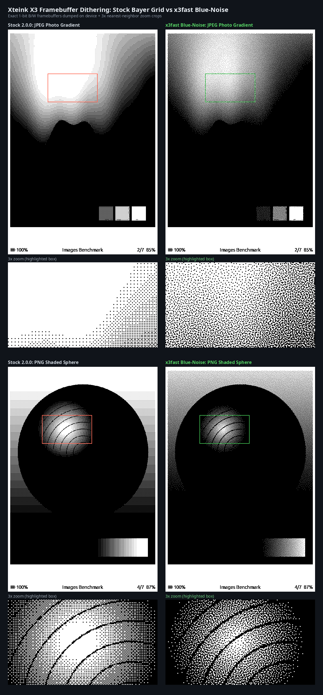

# CrossPoint Reader (x3fast)

Fast Xteink X3 fork of [CrossPoint Reader](https://github.com/crosspoint-reader/crosspoint-reader) 2.0.0 for UC8279 and UC8253 panels. Paired with [Newarr/freeink-sdk](https://github.com/Newarr/freeink-sdk). Upstream `develop` stays untouched for syncing.

- Download: [v2.0.0-x3fast7 release](https://github.com/Newarr/crosspoint-reader/releases/tag/v2.0.0-x3fast7)
- Full benchmark data: [docs/x3fast-benchmark.md](docs/x3fast-benchmark.md)
- Hardware SDK fork: [Newarr/freeink-sdk](https://github.com/Newarr/freeink-sdk)

## Benchmarks on Xteink X3

Measured on an Xteink X3 (UC8279, 528x792) running the same 5 chapter EPUB on stock 2.0.0 and `x3fast`.



| Action | Stock 2.0.0 | x3fast |
|---|---:|---:|
| Page turn | 566 ms | **286 ms** (2.0x) |
| Rapid 4 tap skim | 1,195 ms (2/4 moved) | **933 ms** (4/4 moved) |
| Chapter turn | 905 ms | **434 ms** (2.1x) |
| Cold JPEG / PNG / GIF | 1,790 / 2,226 / 1,367 ms | **553 / 562 / 683 ms** (2.0x to 4.0x) |
| Skip during image load | 3,343 / 3,762 / 2,469 ms | **400 / 394 / 575 ms** (4.3x to 9.5x) |
| Warm cached image | 738 ms | **560 ms** (1.3x) |
| Sleep wake (app timer) | 1,428 ms (~2 s wall) | **1,110 ms** (15 ms GPIO + panel) |

Idle free DRAM stays unchanged at 131 KB free (114 KB largest block).

## Blue noise dithering

`x3fast` replaces the 4x4 Bayer grid with a 64x64 blue noise threshold matrix for 1 bit images, removing staircase banding on gradients.



## What changed

### Display and waveforms

- **UC8279 SPI clock**: raised from 10 MHz to 20 MHz, cutting plane transfer time in half.
- **UC8279 fast DU waveform**: shortened from 26 frames to 14 frames at 200 Hz (286 ms turn floor).
- **UC8253 fast waveform**: shortened from 18 frames to 6 frames at 80 Hz.
- **LUT bank caching**: skips re-uploading waveform tables when the active bank has not changed.
- **Next page staging**: renders and uploads the next page in the background so a button press triggers the refresh right away.
- **Idle panel power off**: turns the panel rail off after 30 s idle without losing the display baseline.
- **Standby wake sync**: keeps the sleep framebuffer for fast wake on `Quick Resume` and `Blank`, and runs one clean full flash on all other sleep screens while keeping turn 1 at 286 ms.

### Input and turns

- **Async button sampler**: polls X3 buttons every 5 ms on a FreeRTOS task with 5 ms debounce so short taps during renders are never missed.
- **Idle wake polling**: wakes in 5 ms slices (3 ms on active contact) instead of 50 ms sleeps.
- **Turn netting and skim mode**: merges rapid taps instead of dropping them (4 of 4 pages moved vs 2 of 4 on stock).

### Reader, images, and fonts

- **Background chapter prebuild**: lays out the next chapter while you read (2 pages per tick when free heap is at least 32 KB), dropping chapter turns from 905 ms to 434 ms.
- **Progressive image display**: shows 1 bit B/W first, then upgrades to 4 level gray after 250 ms.
- **Cancellable image decodes**: aborts JPEG, PNG, and GIF decodes immediately when you turn past an image page.
- **Font caching**: adds a 128 KB flash blob cache, a 48 entry (4 KB) glyph ring, and a 768 entry advance cache.
- **Debounced progress saves**: batches progress writes (1.5 s debounce, 15 s max) into atomic A/B files.
- **Truncated read guard**: bounds string deserialization to 64 KB with soft failure so SD read errors do not crash the reader.

### Power, standby, and storage

- **Light sleep standby**: uses ESP32 C3 light sleep for up to 1 hour before deep sleep, waking from GPIO in 15 ms.
- **Busy wait light sleep**: sleeps the CPU while the display `BUSY` line is active.
- **Cached battery reads**: polls the X3 fuel gauge every 30 s and drops invalid reads above 100%.
- **SD card remount on wake**: probes the card over SPI (`CMD58`) after standby and remounts cleanly if the card was removed.
- **Trimmed BLE buffers**: shrinks C3 NimBLE event queues (8 events, 4 discardable) and runs the BT controller from flash.

## Install

1. Download `crosspoint-2.0.0-x3fast7.bin` from [Releases](https://github.com/Newarr/crosspoint-reader/releases).
2. Copy the file to the root of your X3 SD card.
3. Open CrossPoint on your X3 and flash it through the SD firmware updater.

## Build from source

```bash
git clone --recurse-submodules https://github.com/Newarr/crosspoint-reader.git
cd crosspoint-reader
pio run -e x3_fast
```

The built firmware is written to `.pio/build/x3_fast/firmware.bin`.

## Upstream and license

Based on [crosspoint-reader/crosspoint-reader](https://github.com/crosspoint-reader/crosspoint-reader) under the MIT [LICENSE](LICENSE). See [USER_GUIDE.md](USER_GUIDE.md) for general CrossPoint usage.
