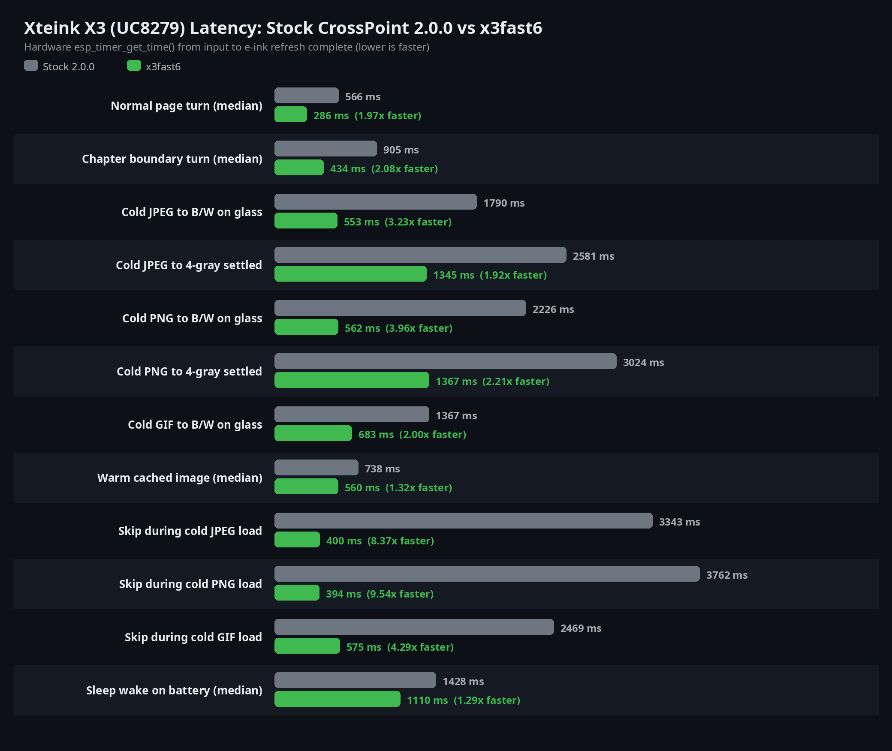
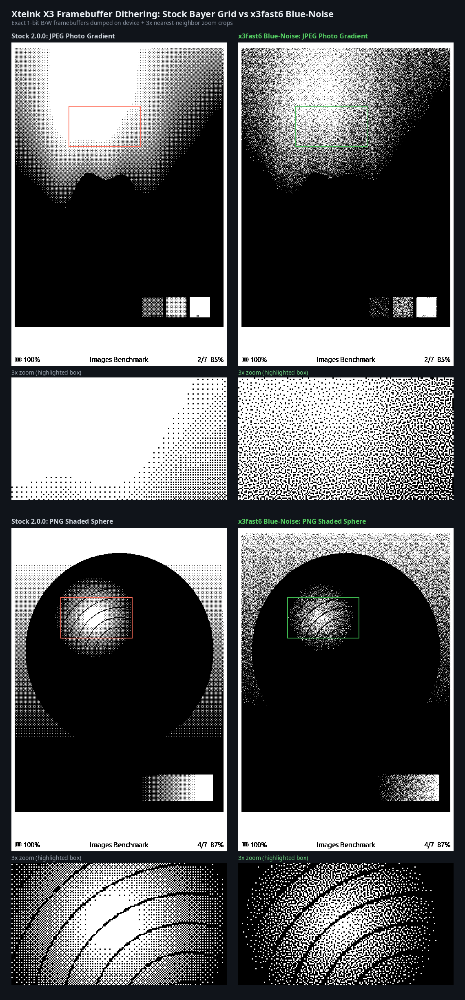

# Xteink X3 Benchmark: Stock CrossPoint 2.0.0 vs `x3fast`

Both builds ran the same self contained 5 chapter EPUB (`bench_x3.epub`) on the same Xteink X3 (UC8279 controller, 528x792 display) with identical `esp_timer_get_time()` hooks from input to panel refresh end.

## Latency Comparison

| Metric | Stock 2.0.0 | `x3fast6` | Speedup | Notes |
|---|---:|---:|---:|---|
| Normal page turn (median, 4 turns) | 566 ms | 286 ms | **1.97x** | Staged next page hits hardware LUT floor (`286` to `289 ms`) |
| 4 tap rapid skim (150 ms apart) | 1,195 ms | 933 ms | **1.28x** | Stock dropped 2 of 4 taps (`2/4` moved). `x3fast` landed all `4/4` (`454 ms` after last tap) |
| Chapter boundary turn (median, 3 chapters) | 905 ms | 434 ms | **2.08x** | Prebuilt `4/4` chapters in background (`0 ms` parse vs `166` to `320 ms` on stock) |
| Cold JPEG to B/W on glass | 1,790 ms | 553 ms | **3.23x** | Deferred 4 gray finishes at `1,345 ms` vs `2,581 ms` on stock (`1.92x`) |
| Cold PNG to B/W on glass | 2,226 ms | 562 ms | **3.96x** | Deferred 4 gray finishes at `1,367 ms` vs `3,024 ms` on stock (`2.21x`) |
| Cold GIF to B/W on glass | 1,367 ms | 683 ms | **2.00x** | Full settled `1,207 ms` vs `1,740 ms` on stock (`1.44x`) |
| Warm cached image (median) | 738 ms | 560 ms | **1.32x** | Cached JPEG `549 ms`, PNG `560 ms` |
| Skip during cold JPEG load | 3,343 ms | 400 ms | **8.37x** | Aborted JPEG decode at `153 ms`. Stock blocked until full decode ended |
| Skip during cold PNG load | 3,762 ms | 394 ms | **9.54x** | Aborted PNG decode at `153 ms`. Stock blocked until full decode ended |
| Skip during cold GIF load | 2,469 ms | 575 ms | **4.29x** | Aborted GIF decode at `328 ms`. Stock blocked until full decode ended |
| Cold book open | 2,038 ms | 2,011 ms | 1.01x | First open before any background work |
| Battery sleep wake (median) | 1,428 ms (6 samples) | 1,110 ms (4 samples) | **1.29x** (app timer only) | Standby wakes from GPIO edge in `15 ms` + panel wake. Stock `1,428 ms` excludes ~500 to 700 ms of power hold, ROM boot, and bootloader (~2.0 s wall time) |

Idle free DRAM stayed comparable (`134,552 B` on stock vs `131,272 B` on `x3fast6`, both with `114,676 B` largest contiguous block).

## Image Quality: Stock Bayer Grid vs Blue Noise

Both firmwares saved their exact 1 bit B/W framebuffers directly to the SD card after rendering Chapter 4 images. `x3fast` replaces the ordered grid with a 64x64 blue noise threshold matrix, removing staircase banding and keeping smooth tonal gradients.

